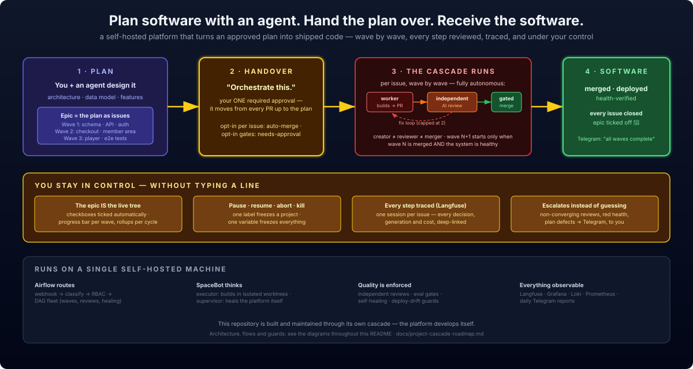
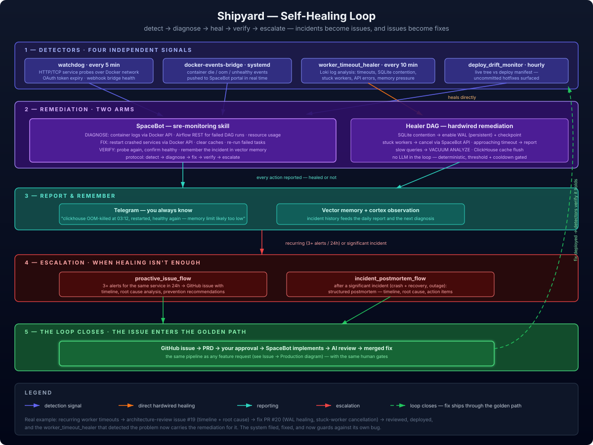
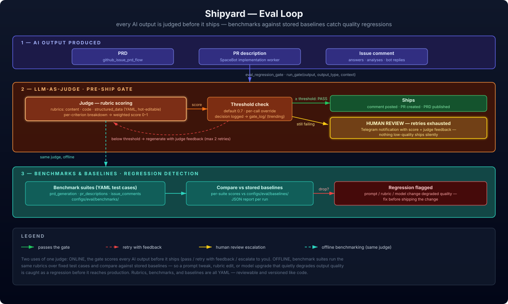
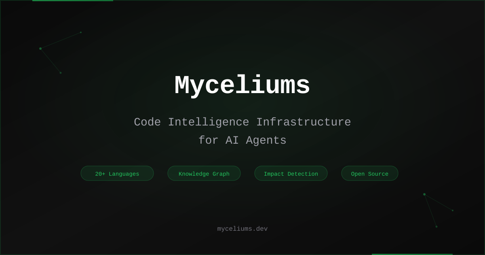

# Marc Mantei — Senior AI Engineer

I build self-regulating AI systems: closed control loops that plan, implement, review, and ship software — with the human as approver, not operator.

10+ years of production infrastructure behind it, from terabyte-scale data pipelines at Netflix (Eyeline Studios) to autonomous multi-agent platforms. My thesis: AI work is only trustworthy inside a feedback loop with a measured signal, an actuator, a setpoint, and a proof.

> Built automation infrastructure for [Eyeline Studios'](https://eyelinestudios.com/en/studios/stages) production pipelines at Netflix, processing terabytes across 100+ concurrent data sources with async orchestration and distributed queues.

---

### Shipyard — Self-Managing AI Platform

A self-hosted platform where AI owns the software lifecycle end to end: issue triage → PRD → implementation → independent review → merge → report. ~450 PRs shipped in its first 9 weeks — 77 commits authored by the platform's own bots.

The architecture separates deterministic orchestration (Apache Airflow: routing, RBAC, retries) from reasoning (a Rust agent runtime on Claude Opus). Around that core runs a fleet of **~20 closed control loops**, each with a measured signal, an actuator, a setpoint — and a proof. Ten complete loop scenarios (convergence, oscillation, plateau, crash-resume) are replayed as regression tests.

- **Review ↔ fix loop** — findings → adversarial verification → weighted error → fix worker → re-review. Converged bot PRs auto-merge behind hard gates; plateau or oscillation escalates to a human
- **LLM-as-judge quality gates** — every deliverable scored against a rubric before it ships; dual-judge divergence fails toward a human
- **Self-healing** — watchdogs detect worker timeouts, orphaned dispatches, and lost webhooks, classify the root cause, and remediate. Proven end to end: a recurring timeout auto-filed its own architecture issue, which became the fix PR the healer now carries
- **Hill-climbing engine** — every 6 hours, production traces are clustered into failure patterns and filed as improvement issues. The system proposes; it never self-modifies
- **Confidence calibration** — weekly Brier-score checks verify that a self-reported 0.8 actually means ~80% correct

| Self-healing loop | Evaluation loop |
| --- | --- |
|  |  |

Guardrails are structural: the worker that builds a PR never reviews it, no agent merges its own work, every event passes an RBAC gauntlet, and every LLM call is traced with per-generation cost (Langfuse + Prometheus/Grafana). 20+ containers on my own hardware — zero infrastructure cost.

**Scale:** ~66k LOC · 40 Airflow DAGs · 109 test files · 20+ containers
**Stack:** Python · Apache Airflow · Rust agent runtime · Claude Opus/Haiku · Langfuse · Prometheus · Loki · Grafana · PostgreSQL · Docker

---

### Myceliums — Code Knowledge Graph

A ~57,000-line Rust engine that parses codebases into a queryable knowledge graph, so AI agents understand architecture before they write a single line. Published on [crates.io](https://crates.io/crates/myc), Homebrew, and Docker. Fully local — no cloud, no telemetry.

Benchmarked against six real open-source repos (Django, FastAPI, Tokio, Express, Zod, Gin): **~99.8% token reduction** and ~94% fewer tool calls versus file-reading agents, with cached lookups around 50 ms.

- 7-crate Rust workspace: core, storage, MCP server, Cypher engine, HTTP server, benchmarks, CLI
- Parses 23 languages via tree-sitter
- Hybrid search: BM25 + local ONNX embeddings fused via Reciprocal Rank Fusion, optional cross-encoder reranking, LanceDB vector store with automatic IVF-PQ indexing
- Impact analysis: parses the git diff, then walks the call graph to map a change's blast radius
- Graph intelligence: Leiden community detection, centrality, cycle detection, architecture linting and drift detection
- 12 MCP tools with one-command setup for 12 editor platforms

**Stack:** Rust · tree-sitter · LanceDB · fastembed · MCP · Cypher

---

### What I work with

---

### GitHub Stats

  <picture>
    <source media="(prefers-color-scheme: dark)" srcset="https://streak-stats.demolab.com?user=marcmantei&theme=github-dark-blue&hide_border=true&v=2" />
    <source media="(prefers-color-scheme: light)" srcset="https://streak-stats.demolab.com?user=marcmantei&theme=default&hide_border=true&v=2" />
    
  </picture>

<picture>
  <source media="(prefers-color-scheme: dark)" srcset="https://github-readme-activity-graph.vercel.app/graph?username=marcmantei&theme=github-dark&hide_border=true&area=true&v=2" />
  <source media="(prefers-color-scheme: light)" srcset="https://github-readme-activity-graph.vercel.app/graph?username=marcmantei&theme=github-light&hide_border=true&area=true&v=2" />
  
</picture>
