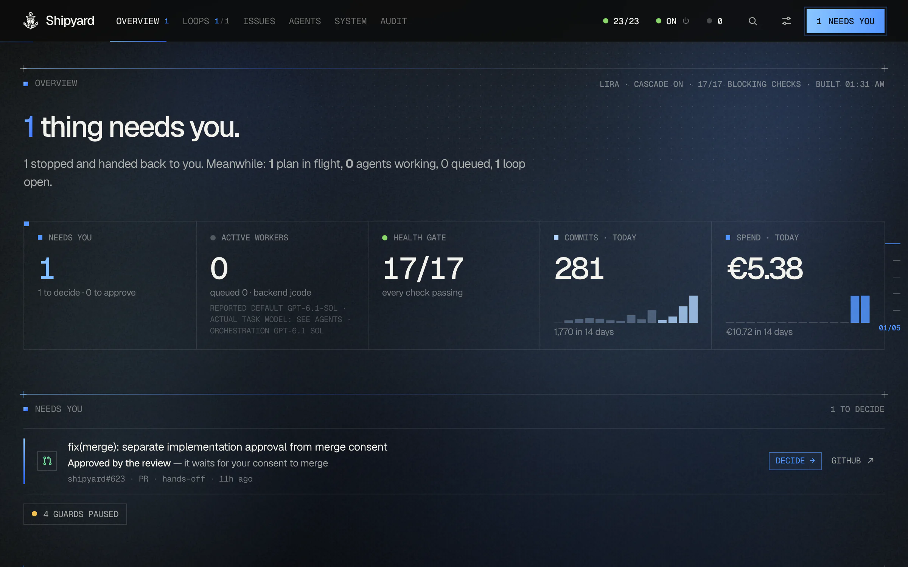
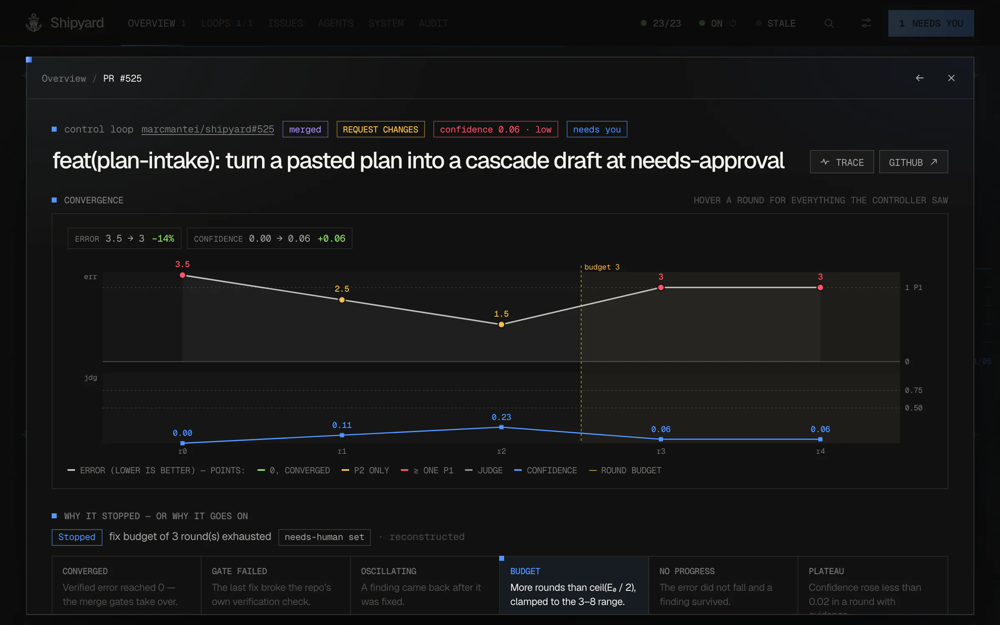
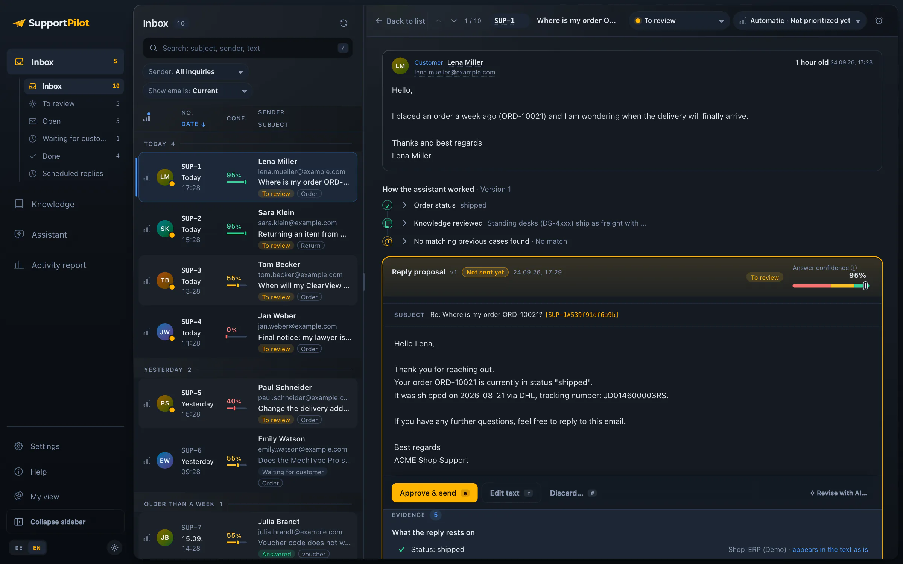
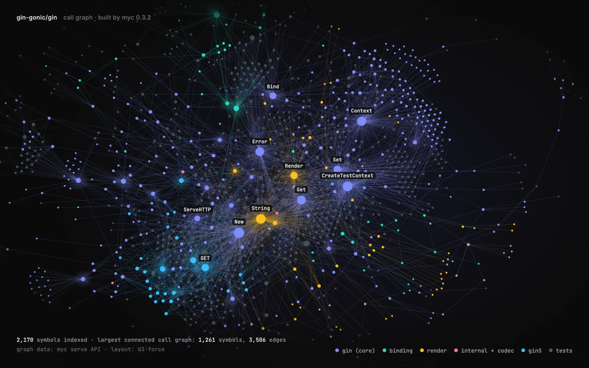
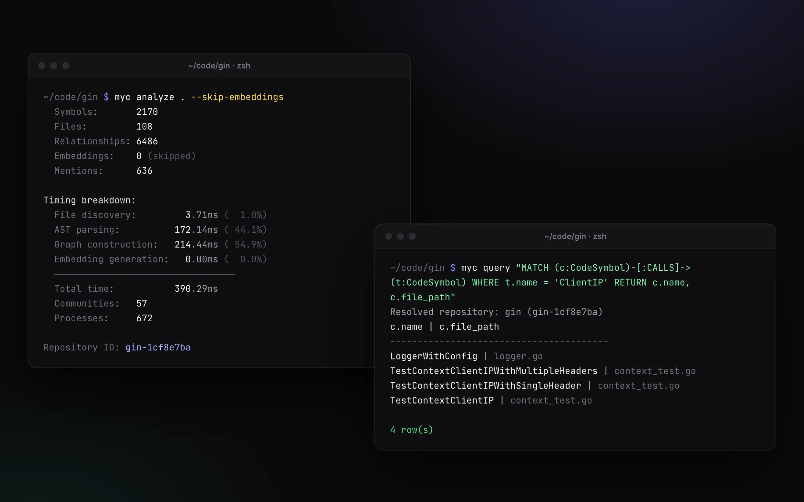
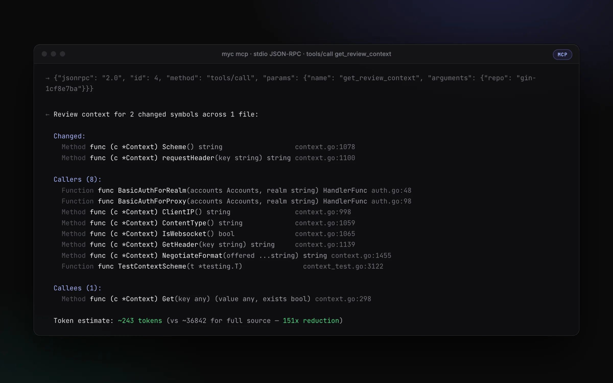

# Marc Mantei · Senior AI Engineer

**Forward Deployed Engineer** · AI systems, platforms, advisory · based in Germany

I build self-regulating AI systems: closed control loops that plan, implement, review and ship software, each with a measured signal, a setpoint and a proof. The human approves; the system operates.

More than ten years of workflow automation, from Netflix's virtual production stages to AI systems that ship software on their own. Now: founder of SupportPilot, building Shipyard and Myceliums. Open for senior AI engineering roles, freelance projects in AI workflow automation, and advisory.

> At [Eyeline Studios](https://eyelinestudios.com/en/studios/stages) (Netflix) I built key production tools for the virtual production stages (LED volumes, volumetric capture, the Light Dome) and automated terabyte-scale data workflows across 100+ sources, with C++/Python API bridges and global CI/CD.

<picture>
  <source media="(prefers-color-scheme: dark)" srcset="assets/commit-graph-dark.svg" />
  <source media="(prefers-color-scheme: light)" srcset="assets/commit-graph-light.svg" />
  
</picture>

---

### Shipyard · A self-hosted platform where AI ships software

AI agents write code fast, but unattended output is hard to trust. Shipyard turns an approved plan into merged software: independent AI workers build, review and fix each issue, wave by wave. Every automated decision runs inside a closed control loop with a measured signal, a hard cap and an escalation path to a human. In production since May 2026.

*Mission Control, live: the fleet in one sentence, and only what needs a person on top.*

Shipyard opened **267 pull requests** on its own across 10 repositories. **240 were merged**: 75 by its own merge gates, 165 by me. About 90% of the commits in my repositories over the last six months were written by it. Over 1 billion tokens metered, 276 PRs through its AI reviewer (as of 24 Sep 2026).

- **11 plans shipped end to end**, each closed only after its acceptance check passed in a throwaway container
- **125 PRs sent back to be fixed**: the reviewer found something at least once in 125 pull requests, twice in 30, three times in 6
- **81 escalations since July**: when the error stops falling or the round budget runs out, it stops and asks. It raised 78 of them itself
- **1 plan → 7 merged PRs**: a terrain generator went from one approval to seven merged pull requests for €16.23 of model time at list price

*A loop's flight recorder: error, judge and confidence per round, and which of six rules stopped it.*

Six loop families, nested by timescale, so every ring can stop what runs inside it: the eval loop on every AI output, the build loop per issue, the cascade every ten minutes, the hill-climbing engine every six hours. The review budget is earned by the size of the problem (3 to 8 rounds), and loop state lives on the PR itself, so it survives restarts. Guardrails are structural: the worker that builds a PR never reviews it, and no agent merges its own work.

[Control loop atlas](https://www.marcmantei.com/shipyard/index.html) · [Loop sheet](https://www.marcmantei.com/shipyard/control-loops.html)

**Stack:** Python · Apache Airflow · FastAPI · Claude · Grok · PostgreSQL · Redis · Langfuse · OpenTelemetry · Prometheus · Grafana · Loki · Docker

---

### SupportPilot · An AI support desk that earns its autonomy

Any model can write a plausible support email. The hard part is knowing when one is safe to send unread. SupportPilot drafts replies from the knowledge base and live order or booking data, checks every order number, tracking number and price against it, and lets unit-tested code, not the model, decide what needs a human. It is Shipyard's merge-gate loop, applied to customer email. Pre-launch.

**7** hard gates before any auto-send · **4** possible outcomes per draft · **1,798** backend tests on SQLite and Postgres · **1,061** commits in 29 days, merges not counted

---

### Myceliums · A code knowledge graph for AI agents

Coding agents answer structural questions by grepping and reading whole files, which burns context and still misses indirect callers. Myceliums is a local Rust engine that parses a repository into a graph of symbols, calls, communities and execution flows, and serves it over MCP. One tool call returns callers, blast radius or a Cypher result as compact text. Open source (Apache-2.0), v0.3.2, fully local: no cloud, no telemetry.

*Gin's call graph as built by Myceliums: 1,261 connected symbols, colored by package.*

  
  

*Left: `myc analyze` indexes Gin in 390 ms of parsing, then a Cypher query lists every caller of `ClientIP`. Right: one MCP call on a one-line change returns its callers and callees in about 243 tokens.*

Benchmarked on six open-source repos (Django, FastAPI, Tokio, Express, Zod, Gin): **~99.8% fewer tokens** and ~94% fewer tool calls than file-reading agents.

**23** languages parsed · **54** MCP tools for agents · **14** one-command integrations · **~60k** lines of Rust

[Website](https://myceliums.marcmantei.com) · [GitHub](https://github.com/marcmantei/myceliums) · [crates.io](https://crates.io/crates/myc)

**Stack:** Rust · tree-sitter · LanceDB · fastembed · MCP · Cypher

---

### What I work with

The commit graph above is rendered by [`scripts/commit_graph.py`](scripts/commit_graph.py) and refreshed daily by a GitHub Action: no third-party service, private repositories counted, their names never published.
